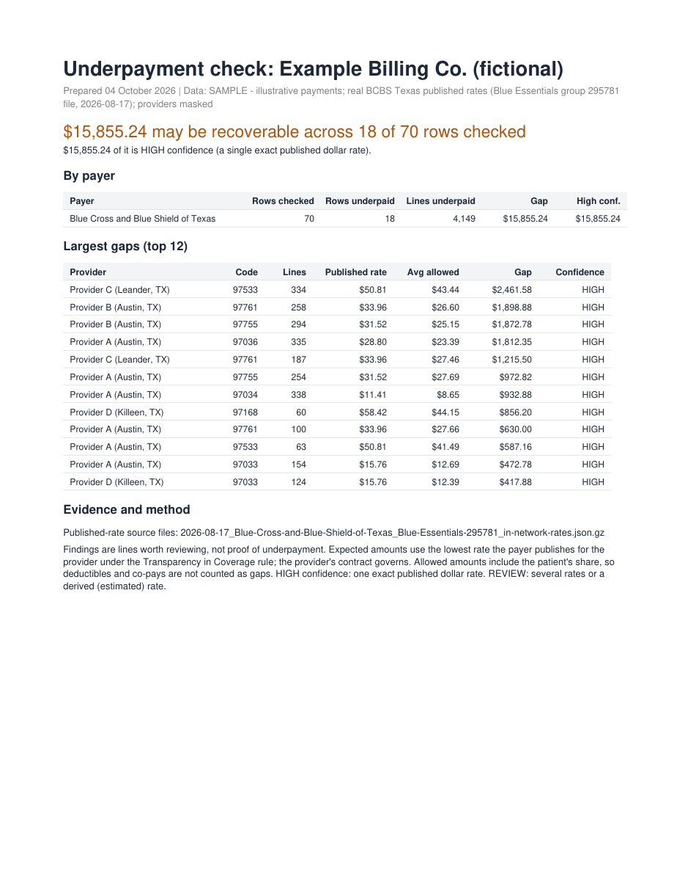

# Underpayment Checker


Underpayment Checker is a data pipeline. It finds US insurance payments that are less than the rate
that the insurer publishes for the provider. It makes a one-page PDF report and a draft appeal letter.

## The problem
The US *Transparency in Coverage* rule became active in 2022. The rule tells health insurers to
publish the rates that they agree with each provider. Insurers publish these files each month.

Clinics seldom compare their payments with these rates. An underpayment arrives as a normal payment.
Thus no process fails, and nobody sees the missing money. This project does the comparison.

> **Data:** The published rates are real. They come from the public files of Blue Cross and Blue
> Shield of Texas. The payments are illustrative. The example report hides the names of the
> providers. The project uses no patient data.



## How it works

```
Insurer index (monthly) ─► select one network rate file (for example, 2.4 GB gzipped JSON)
Rate file ─► read one time as a stream ─► keep target codes and providers ─► bronze ─► silver ─┐
Payment totals (CSV) ─► validate, reject patient-level columns ─► bronze ─► silver ────────────┤
                                                                                               ▼
                                        gold: expected amount compared with the paid amount
                                                     ├─► PDF report
                                                     └─► appeal letter
```

1. **Ingestion.** A streaming JSON parser (`ijson`) reads the rate file one time. It never loads a
   multi-gigabyte file into memory. Downloads continue after a break. A client for the NPPES
   registry identifies the providers.
2. **Transformation.** Plain SQL on DuckDB builds the bronze, silver and gold layers.
3. **Outputs.** ReportLab makes the one-page PDF. A fixed template writes the appeal letter. As an
   option, an LLM writes the letter from aggregated findings only. A Streamlit dashboard shows the
   results.

The full design and all matching rules are in [`docs/ARCHITECTURE.md`](docs/ARCHITECTURE.md).

## Lessons from the real data
The real BCBS Texas files showed four problems. Simple test data does not show these problems.

1. **The rates have no billing-code modifiers.** Therapy claims always have a modifier (GP, GO or
   GN). A match on the modifier finds nothing. Thus the pipeline uses the rate without a modifier.
   If a rate for the exact modifier exists, the pipeline uses that rate.
2. **The tax IDs have a dash in the payer file** (for example, `76-0221050`). Billing exports have
   no dash. The matches failed without an error. The pipeline now removes the dash on both sides.
3. **The provider references come before the rates.** Thus one streaming pass is sufficient for a
   multi-gigabyte file. Two passes are not necessary.
4. **Some published rates are not dollar amounts.** A "percentage" rate is a percent of the billed
   charges. The pipeline ignores these rates. A "derived" rate is an estimate from past claims.
   The pipeline marks it REVIEW, not HIGH.

## Matching rules (summary)
| Rule | Reason |
|---|---|
| Compare the **allowed** amount (payer payment plus patient share). | Deductibles and co-payments are not underpayments. |
| Use the **lowest** valid published rate. | Each flag is then true for the least favourable reading. |
| Flag a row only if the gap is more than 2 % **and** more than $50. | Small differences are noise. You can change the limits. |
| Set HIGH confidence only for one exact dollar rate. | Estimates show as REVIEW. |

## Quick start
```bash
pip install -e ".[dev]"
pytest                                           # 98 tests. The tests need no network.
upc sample-report --rates <bronze_rates.parquet> # illustrative payments -> PDF and letter
```

Sequence for real data:
```bash
upc list-rate-files --index <payer_index.json> --keyword "Blue Choice PPO"
upc download --url "<rate file url>" --dest data/raw/<file>.json.gz
upc ingest-rates --source data/raw/<file>.json.gz --payer BCBSTX --all-providers
upc select-providers --from-rate-file --top 5
upc sample-report
```

## Input format
The input file contains totals only. It contains no patient data.

* Required columns: `provider_npi, payer_id, cpt, year, line_count, total_allowed`
* Optional columns: `provider_tin, modifier, place_of_service, min_allowed, max_allowed`

The loader rejects a file that has patient-level or claim-level columns, for example names, member
IDs, claim IDs or service dates. It rejects the file before it stores any data.

## Project layout
```
src/underpayment_checker/
  ingestion/    payer index reader, resumable download, streaming rate parser,
                NPPES client, loader for customer totals
  transform/    silver and gold SQL, and the SQL runner
  report/       findings, PDF report, appeal letters
  sample_data/  illustrative payments with an answer key
  app/          Streamlit dashboard
tests/          98 tests on a fictional rate file with the same structure as the real file
reference/      target codes (CMS CY2026 Therapy Code List) and payer index URLs
examples/       example report and appeal letter
```

## Limits
* The published rates are not the contract. Each finding is a line to examine, not a proof.
* The current configuration has one payer (BCBS Texas) and physical-therapy codes.
* The reports show code numbers without CPT descriptions.

## Technology
Python 3.11+, DuckDB, ijson, pandas, pyarrow, ReportLab, pytest, ruff, GitHub Actions.
